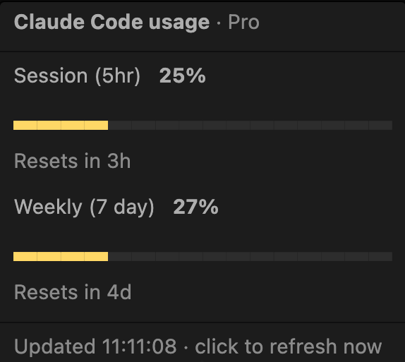

# Claude Usage Status

VS Code extension that shows your Claude plan usage in the status bar.



Status bar: `Claude: 25% | 27%`

- **First number** — current 5-hour session window
- **Second number** — weekly window
- Turns yellow at 80%, red at 95%
- Hover for a bar per limit (session, weekly, Opus, Sonnet) and when each resets
- Click to refresh — no popups

## How it works

Account-wide numbers, so usage from every device counts.

1. Finds Claude Code's login on this machine (see below).
2. Calls `GET https://api.anthropic.com/api/oauth/usage` — the endpoint behind `/usage`.
3. Refreshes every 5 minutes and on window focus (at most once a minute). On `429` it backs off and keeps the last values.

The last result is cached in VS Code's extension storage so reloads show it instantly without hitting the API again. No credentials are stored.

> The usage endpoint is undocumented and may change without notice.

## Where the login comes from

There is no separate sign-in: the extension reuses the login Claude Code already has. It only **reads** it — it never refreshes or rewrites the token, so it can't log Claude Code out. If the token has expired, run any Claude Code prompt to renew it, then click the status bar item.

Claude Code stores its login differently per OS:

| OS | Location |
| --- | --- |
| macOS | Keychain, service `Claude Code-credentials`. Several accounts can exist (Claude Code writes under your macOS username; older tools left a `credentials` one) — all are checked and the freshest wins. First read triggers a one-time "allow access" prompt. |
| Windows | `%USERPROFILE%\.claude\.credentials.json` |
| Linux | `~/.claude/.credentials.json` |

The credentials file is checked on every OS; if both it and the Keychain have a login, the one expiring last is used.

## Settings

| Setting | Default | Description |
| --- | --- | --- |
| `claudeUsageStatus.alignment` | `left` | Status bar side: `left` or `right`. Sits at the inner edge, nearest the centre. |
| `claudeUsageStatus.configDir` | `""` | Folder that holds `.credentials.json`. Supports `~`. |

The folder is resolved in this order:

1. `claudeUsageStatus.configDir`, if set
2. `CLAUDE_CONFIG_DIR` environment variable
3. `~/.claude`

Example (`settings.json`):

```json
"claudeUsageStatus.configDir": "~/work/.claude"
```

Changing the setting refreshes immediately.

## Requirements

- macOS, Windows or Linux
- Logged in to Claude Code with a Pro/Max subscription

## Build & install

```sh
npx @vscode/vsce package --allow-missing-repository --skip-license
code --install-extension claude-limits-status-<version>.vsix --force
```

Then run **Developer: Reload Window**.

## Troubleshooting

| Shows | Meaning |
| --- | --- |
| `Claude: —` | No data yet; hover for the reason |
| token expired | Run any Claude Code prompt to renew the login, then click |
| rate limited | Too many calls; disable other usage extensions and wait |
